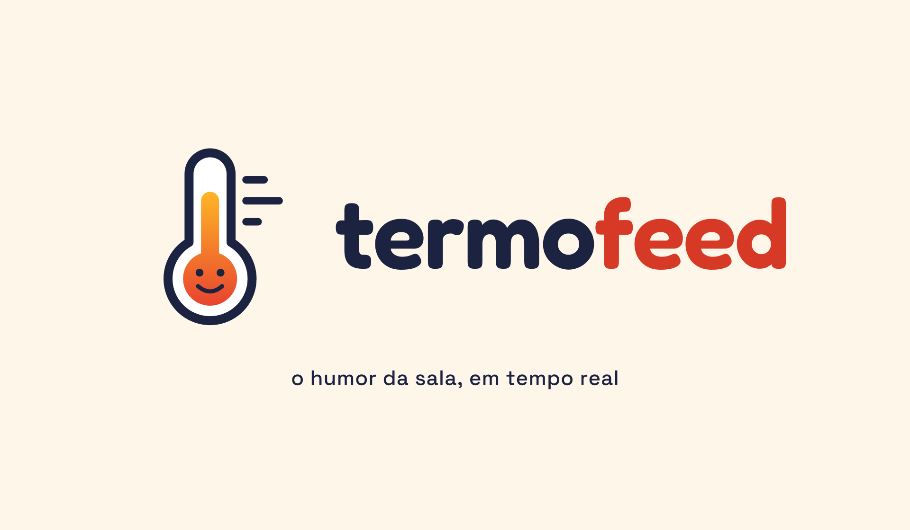

<p align="center">
  <picture>
    <source media="(prefers-color-scheme: dark)" srcset="cnt/03-logo-fundo-escuro.png">
    
  </picture>
</p>

# termofeed-specs

Especificações do **Termofeed**, o termômetro de humor para salas virtuais.

O Termofeed funciona como uma sala do Google Meet, mas sem vídeo. Os participantes entram por um link, sem cadastro, e reagem com emojis. O app mostra os emojis mais usados em uma janela de tempo.

Este repositório não tem código da aplicação. Ele guarda os requisitos, os contratos da API, a identidade visual e os prompts usados para implementar o produto.

| Repositório | Conteúdo |
|---|---|
| `termofeed-specs` | Especificações (este repositório). |
| `termofeed-back` | Back-end em Go. |
| `termofeed-front` | Front-end em React e ambiente completo de produção. |

## Estrutura

```
cnt/
  requisitos-funcionais.md       # RF-001 a RF-035
  requisitos-nao-funcionais.md   # RNF-001 a RNF-024
  openapi.yaml                   # contrato REST (OpenAPI 3.1)
  asyncapi.yaml                  # eventos WebSocket (AsyncAPI 3.0)
  01 a 06-*.png                  # logos e ícones
prompts/
  prompt-backend-go.md           # implementação do termofeed-back
  prompt-frontend.md             # implementação do termofeed-front
```

## Documentos

- [Requisitos funcionais](cnt/requisitos-funcionais.md): salas, entrada, reações, resumo, extensão e encerramento.
- [Requisitos não funcionais](cnt/requisitos-nao-funcionais.md): desempenho, segurança, privacidade, acessibilidade e operação. Os números são valores propostos e podem mudar conforme o orçamento e o público real.
- [Contrato REST](cnt/openapi.yaml): endpoints, esquemas e códigos de erro.
- [Contrato de eventos](cnt/asyncapi.yaml): mensagens que o servidor envia por WebSocket.
- [Prompt do back-end](prompts/prompt-backend-go.md) e [prompt do front-end](prompts/prompt-frontend.md): stack, arquitetura, testes, hospedagem e critério de pronto de cada repositório.

## Regras do produto

| Regra | Valor |
|---|---|
| Duração inicial da sala | 5 a 240 minutos |
| Extensão por pedido | 5 a 60 minutos |
| Duração total máxima | 480 minutos |
| Intervalo entre reações | 1 a 60 segundos (padrão: 5) |
| Paleta de emojis | 2 a 12 emojis (padrão: 8) |
| Participantes por sala | 2 a 200 (padrão: 200) |
| Janelas do resumo | `30s`, `1m`, `5m` e `all` |
| Retenção depois do encerramento | 24 horas |

Não existe login, e as reações são anônimas. Dois tokens controlam o acesso:

- `hostToken`: a API devolve ao criar a sala. Permite estender e encerrar.
- `participantToken`: a API devolve ao entrar na sala. Permite reagir e abrir o WebSocket.

## API

A URL base é `/api/v1`.

| Método | Caminho | Função | Token |
|---|---|---|---|
| `POST` | `/rooms` | Cria a sala. | Nenhum |
| `GET` | `/rooms/{code}` | Consulta os dados públicos da sala. | Nenhum |
| `POST` | `/rooms/{code}/join` | Entra na sala. | Nenhum |
| `POST` | `/rooms/{code}/reactions` | Envia uma reação. | `participantToken` |
| `GET` | `/rooms/{code}/summary` | Consulta o resumo por janela. | Nenhum |
| `POST` | `/rooms/{code}/extend` | Aumenta o tempo da sala. | `hostToken` |
| `POST` | `/rooms/{code}/close` | Encerra a sala. | `hostToken` |
| `GET` | `/rooms/{code}/ws` | Abre o WebSocket. | `participantToken` |

O cliente só recebe eventos pelo WebSocket: `reaction.created`, `summary.updated`, `participants.changed`, `room.expiring`, `room.extended` e `room.closed`. As reações são enviadas por REST.

## Identidade visual

| Arquivo | Uso |
|---|---|
| [`01-logo-principal.png`](cnt/01-logo-principal.png) | Logo com slogan, em fundo creme. |
| [`02-logo-horizontal-transparente.png`](cnt/02-logo-horizontal-transparente.png) | Logo horizontal para fundos claros. |
| [`03-logo-fundo-escuro.png`](cnt/03-logo-fundo-escuro.png) | Logo em fundo azul-marinho. |
| [`04-icone-app.png`](cnt/04-icone-app.png) | Ícone do app, em fundo coral. |
| [`05-icone-colorido-transparente.png`](cnt/05-icone-colorido-transparente.png) | Ícone colorido. |
| [`06-icone-uma-cor.png`](cnt/06-icone-uma-cor.png) | Ícone em uma cor. |

As cores e a tipografia estão no [prompt do front-end](prompts/prompt-frontend.md#direção-de-design).

## Como usar

1. Crie ou abra o repositório de destino (`termofeed-back` ou `termofeed-front`).
2. Deixe o diretório `cnt` acessível ao agente ou à pessoa que vai implementar.
3. Use o prompt correspondente em `prompts/`.

## Como alterar

- Os contratos são a fonte da verdade. Ao mudar uma regra, atualize na mesma alteração os requisitos, o `openapi.yaml`, o `asyncapi.yaml` e os prompts afetados.
- Mantenha os IDs existentes (`RF-*` e `RNF-*`), porque a rastreabilidade dos outros repositórios depende deles.
- Atualize a versão e a data no início do documento alterado.
